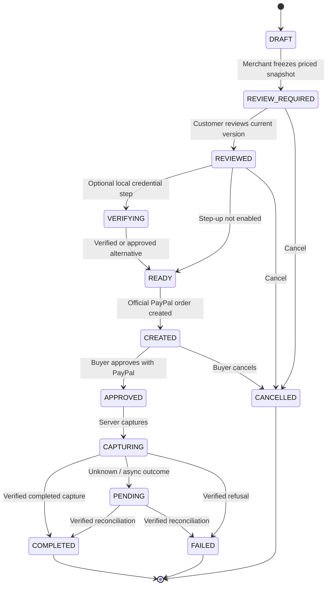

# AccessPay — Universal Accessible Payment Layer

**Master implementation and delivery plan | 30 October 2026 | PayPal AI Hackathon 2026**

**Tagline:** Every payment. Every ability. Every device.

**Short pitch:** An embeddable accessibility layer for merchant checkout. AccessPay turns authoritative merchant transaction data into a clear, screen-reader- and braille-compatible review; lets customers use speech or text to ask questions; supports optional device passkeys and safe draft handoff; and returns a verified payment outcome from PayPal. AI explains and clarifies, while PayPal and deterministic server code control money movement.

## 0. Executive decision and feasibility

**Build:** a merchant-integrated React checkout SDK, a hosted responsive review/PWA, one PayPal sandbox backend, two sample stores consuming the SDK, and manual accessibility testing. **Optional:** Chrome extension side panel with read-only page assistance. **Do not build for the hackathon:** arbitrary-site payment interception, personal PayPal transfers, camera-based face authentication, continuous sign-language translation, or a custodial marketplace.

“Universal” means *consistent across participating merchants and supported browsers/assistive devices*, not unrestricted access to payment pages across the internet. AccessPay is not a payment processor. For the hackathon, both sample stores use **one sandbox seller** but different logical store identities. This demonstrates SDK reuse, not independent live-merchant settlement. Actual onboarding/processing for unrelated sellers may require PayPal partner approval and a different settlement architecture.

**Differentiation from Sightline:** reusable merchant integration, cross-device draft handoff, device-managed WebAuthn, a first-class silent/braille-friendly experience, verified payment states, and actual usability evidence. Do not try to compete on product-catalog feature count or recreate Sightline's voice-first store.

## 1. Target users, problems, and acceptance principles

| User | Input options | Output/feedback | Must not require |
|---|---|---|---|
| Blind, speaking | Keyboard, screen reader, optional microphone, braille input | Native screen-reader speech, braille, persistent structured text | Vision, mouse |
| Blind, non-speaking | Keyboard, braille display/keyboard, switch controls | Screen-reader or refreshable braille text | Voice or sign-language camera |
| Deaf | Keyboard/touch/text, optional sign-language outside MVP | Visual status, captions, persistent text | Audio |
| Deafblind | Braille input/display, keyboard/switch access | Persistent short braille-readable statuses | Sight or hearing |
| Low vision | Zoom, keyboard, dictation | Contrast, large text, predictable layouts | Tiny controls |
| Motor disability | Switch keyboard, keyboard, optional speech | Focused control and readable status | Drag, fast gestures, precise pointer |

Primary jobs: identify the merchant and total; detect surprising fees; correct errors; review before authorizing; navigate PayPal approval; receive definite or explicitly pending payment status; retrieve the record later. Never equate an aria-live announcement with actual braille hardware validation.

Design and test AccessPay-owned content against **WCAG 2.2 AA**; do not call it formally compliant without a comprehensive audit. Merchant pages and PayPal-owned approval surfaces must be tested and disclosed separately.

## 2. Product surfaces and bounded promises

### 2.1 `@accesspay/react` SDK — primary innovation

- Embeddable React `AccessibleCheckout` component with predictable keyboard focus, semantic headings, text-first summary and edit/cancel actions.
- Merchant passes a **server-issued checkout-session reference**, not an arbitrary client-provided price/recipient.
- Merchant creates/updates a cart on its own backend. AccessPay's demo server computes totals and returns an immutable normalized summary bound to the merchant/store, session, items, currency, amount, tax, shipping, expiry and version.
- Components: `AccessPayReview`, `AmountReadback`, `AccessibleError`, `PaymentStatus`, `HelpDrawer`, `ContinueOnPhone`, `PayPalPaymentArea`, `Receipt`.
- SDK adapter interface supports merchant-controlled PayPal order creation/capture for future deployments; do not hardwire every merchant to AccessPay's own PayPal secret.
- Supported locales in MVP: English. Hindi/Hinglish speech is optional if evaluated properly; never advertise broad-language support before localization of deterministic financial strings.

### 2.2 Hosted accessible payment workspace

- URLs such as `/review/:checkoutSessionId` and `/receipts/:receiptId` on an HTTPS AccessPay origin.
- Works in desktop browsers and phone browsers; installable as a PWA where supported.
- Features: screen-reader-first review, large text/high contrast, signed-in saved drafts, typed assistant, optional push-to-talk, session status and non-sensitive receipts.
- Does not request card/PIN/CVV/PayPal password.
- Hosted view is an **alternative representation of a merchant-owned order**, not a new payment merchant or fund custodian.

### 2.3 Optional browser extension

- Chrome/Edge Manifest V3 side panel, opened explicitly by user. Can provide plain-language explanations of **allowlisted or user-permitted** page content and link into an integrated merchant flow.
- No injection into PayPal login, OTP, hosted card fields, or payment-authorize actions. No page-button interception, credential scraping, or arbitrary order submission.
- Entire MVP must work without extension, including mobile Safari/Chrome.

## 3. Demonstration user journeys

**Journey A — Desktop, blind shopper:** Demo Store A product page → tab to “Pay with AccessPay” → NVDA/VoiceOver announces merchant, item, shipping, tax and full amount → “Explain delivery fee” via typed/voice request → grounded answer from merchant data → edit or confirm review → optional passkey check → activate PayPal official button → sandbox buyer approves → backend capture → persistent receipt. The PayPal-owned approval is separately tested; unsupported behavior is honestly reported.

**Journey B — Blind and non-speaking:** Demo Store B → no microphone permissions → accessible keyboard/braille-input pathway → read merchant, amount and status with focus navigation → activate payment control → retrieve receipt. A braille *viewer* is an illustration, not equivalent to a hardware braille test.

**Journey C — Desktop-to-phone:** Review unpaid checkout on desktop → choose “Continue on phone” → receive short-lived pairing code and optional QR → phone opens AccessPay and authenticates as same shopper/explicitly approved device → enter code (not QR-only), see same authoritative review → desktop becomes view-only → phone performs final PayPal approval → verified receipt available on both devices. Draft transfer never transfers payment authorization. Regenerate a one-time code after expiry; redeem exactly once. No payment details or bearer credentials in a plaintext share URL.

**Journey D — Merchant developer:** Demo Store A and Demo Store B both import `@accesspay/react`, call the same typed interface, and get the same accessibility and status behavior. The two stores can use one sandbox seller for the demo. Show an additional code example and integration guide.

**Journey E — Correct failure behavior:** Simulate failed payment or network timeout, display “Not completed” or “Status pending; checking PayPal”, and reconcile with PayPal before allowing retry. Never claim a new payment succeeded merely because approval returned.

## 4. Architecture

```mermaid
flowchart TB
  subgraph Clients[Participating merchants and customer browsers]
    MA[Demo Store A]
    MB[Demo Store B]
    SDK[@accesspay/react SDK]
    WEB[AccessPay hosted web / PWA]
    EXT[Optional Chrome side panel]
    AT[VoiceOver / NVDA / TalkBack / Braille / Keyboard]
  end
  subgraph Service[AccessPay application on Render]
    API[Checkout session API]
    GUARD[Deterministic review and payment policy]
    AI[Read-only AI explanation service]
    AUTH[Sign-in / WebAuthn verification]
    HAND[Draft handoff service]
    PAY[PayPal merchant adapter]
    REC[Receipt and reconciliation]
  end
  DB[(Render Postgres)]
  LLM[Claude / selected LLM]
  PP[PayPal JS SDK v6 + Orders v2]
  HOOK[Signed PayPal webhooks]
  MA --> SDK
  MB --> SDK
  SDK --> API
  WEB --> API
  EXT -.-> WEB
  AT --> SDK
  AT --> WEB
  API --> GUARD
  GUARD --> AUTH
  GUARD --> HAND
  GUARD --> PAY
  API --> AI --> LLM
  API <--> DB
  PAY <--> PP
  PP --> HOOK --> REC
  PAY --> REC
  REC <--> DB
  REC --> API
```

### Ownership boundaries

- **Merchant** owns storefront/cart/inventory, merchandise and authoritative item data, seller PayPal business account, order fulfillment and refunds.
- **AccessPay SDK/UI** owns accessible representation, review controls, safe explanations and focus management; it never owns raw card data.
- **AccessPay demo backend** owns server-issued checkout sessions, validation and PayPal API calls for the *single demo seller*, receipt persistence and reconciliation.
- **PayPal** owns login, payment-source choice, risk/security challenges, buyer approval and the actual payment ledger.
- **AI** sees only allowlisted, redacted merchant facts, and receives no capability to capture or change an amount.

A future real multi-merchant service should use merchant-side gateway adapters or an approved PayPal platform/partner integration. Do not claim live multiparty support based on two demo store skins.

## 5. Technical stack

| Layer | Decision |
|---|---|
| Monorepo | pnpm workspaces + TypeScript shared types |
| Storefronts and hosted app | Next.js 16 App Router + React + TypeScript |
| SDK | `@accesspay/react`, `@accesspay/core`, `@accesspay/merchant-adapter` |
| Styling | Tailwind CSS with semantic HTML and accessible primitives; minimal dependency weight |
| Validation | Zod for shapes, Decimal/integer minor units for money |
| Payment UI | `@paypal/react-paypal-js/sdk-v6`; PayPal Web SDK v6 |
| Payment server | `@paypal/paypal-server-sdk`, REST Orders v2, webhook verification |
| Database | PostgreSQL + Drizzle ORM (or Prisma; choose one only) |
| Authentication | Cookie-based sessions, WebAuthn/passkeys with accessible alternate sign-in |
| AI | Claude (structured extraction and explanation); immutable financial fields rendered by templates |
| Speech | Optional push-to-talk STT adapter; typed interaction always available; OS screen reader owns output |
| Monitoring | Structured logs, OpenTelemetry; scrub personal and payment info |
| Tests | Vitest, Playwright, axe-core, Postman collection, manual AT tests |
| Hosting | Render Node web service + managed Render PostgreSQL + custom HTTPS origin |

Use PayPal's August 2026 official Next.js 16 and v6 React integration guide as the working API baseline, not v5-only `PayPalButtons` examples. Pin dependency versions in the lockfile and verify sandbox behavior.

## 6. SDK developer experience

### Merchant integration interface (conceptual, subject to implementation)

```tsx
<AccessPayProvider
  checkoutSessionId={checkoutSession.id}
  getSession={merchantApi.getSession}
  createPayPalOrder={merchantApi.createPayPalOrder}
  capturePayPalOrder={merchantApi.capturePayPalOrder}
  getPaymentStatus={merchantApi.getPaymentStatus}
>
  <AccessPayReview allowTextHelp allowVoiceHelp={false} />
  <AccessPayCheckout />
  <AccessPayReceipt />
</AccessPayProvider>
```

Public callbacks must be authenticated on the server and not trusted for financial values merely because they are typed. In hackathon demos, a shared mock merchant adapter supplies signed or server-fetched checkout data for two storefronts. The UI may show PayPal SDK components only when eligible and inside a genuine user-click path.

**Normalized session example:**

```json
{
  "sessionId": "cs_demo_01",
  "storeId": "store-a",
  "merchantDisplayName": "Northstar Demo Goods",
  "version": 3,
  "currency": "USD",
  "lineItems": [{"sku":"item-42","name":"Desk lamp","qty":1,"unitMinor":2500}],
  "shippingMinor": 300,
  "taxMinor": 140,
  "totalMinor": 2940,
  "state": "REVIEW_REQUIRED",
  "isSandbox": true
}
```

This object is a **server output**, not an instruction accepted from an untrusted browser. `totalMinor` must be server-recomputed and the session version invalidated on cart mutation. Never substitute arbitrary client JSON directly into the PayPal order create request.

### Core API

- `POST /api/merchant/checkout-sessions` — authenticated demo merchant creates immutable priced snapshot.
- `GET /api/checkout-sessions/:id` — returns authorized, minimally necessary summary.
- `POST /api/checkout-sessions/:id/review` — confirms buyer saw current version; invalidates if cart changed.
- `POST /api/checkout-sessions/:id/passkey/challenge` and `/verify` — optional step-up tied to session/version; use maintained passkey library.
- `POST /api/checkout-sessions/:id/paypal/order` — creates PayPal order using server-side seller credential and locked amount.
- `POST /api/checkout-sessions/:id/paypal/capture` — checks correct order/session and approval, idempotently captures.
- `GET /api/checkout-sessions/:id/status` — final verified or pending state.
- `POST /api/paypal/webhook` — verify PayPal signature, persist event id, reconcile.
- `POST /api/handoff` — one-use code for unpaid draft.
- `POST /api/handoff/redeem` — authenticated target device claims an unpaid draft.
- `POST /api/help/explain` — read-only AI grounded in merchant facts; no financial mutation.
- `GET /api/receipts/:id` — accessible, sanitized receipt.

## 7. Checkout states and invariant rules



Nonnegotiable rules: (1) AI never directly creates/captures/refunds; (2) merchant and amount resolved server-side; (3) checkout session bound to seller, user, currency, total, version; (4) browser passkey does not replace PayPal authorization; (5) use a stable PayPal request id per attempted create/capture, with database uniqueness and transaction-level locks; (6) duplicate webhook ids handled safely; (7) no success announcement until verified PayPal status; (8) any price change invalidates review and requires a fresh confirmation; (9) only one device actively owns an unpaid draft during handoff; (10) never store raw camera imagery, biometric data, PayPal secrets in frontend, or card details.

Do **not** imitate Sightline's ten-second 'undo' as a generic feature. Once a capture has occurred, voiding an authorization is not generally the same as reversing the completed transaction. A simple review-before-payment and cancellation path is more truthful.

## 8. Cross-device handoff design

1. Customer signs into an AccessPay demo account on desktop and opens a draft. No PayPal approval has occurred.
2. Server creates a one-time pairing challenge: random high-entropy secret represented by QR plus a short human-enterable code under strict rate limiting and 60–120 second expiration (starting engineering target, test and tune).
3. Phone must sign in to the same shopper or complete an explicit trusted-device confirmation, then redeem pairing challenge; a QR scan **alone** must not grant authority to pay.
4. Server checks draft is unpaid and not stale. It rotates sessions and marks desktop view-only. Both devices show merchant, items and total.
5. Phone performs review again, optional passkey and official PayPal buyer approval. Backend captures after correct PayPal state.
6. Receipt persists and appears on desktop too, with “Completed on another device” state. If handoff fails, original session can resume safely; outstanding PayPal order isn't duplicated.

Braille or text users must be able to type/read the pairing code, never require QR/camera. Never put user credentials or unexpired payment-authorizing bearer tokens in URLs.

## 9. Accessibility engineering specifics

- Semantic headings with stable landmarks, correct names/roles/values, labels and help text.
- Review order: merchant, items, quantity, subtotal, shipping, tax, total, currency, delivery, return policy, change/cancel/continue.
- Exact amount is generated from integer minor units, with localized accessible labels (“29 dollars and 40 cents”), not AI speech or string parsing.
- Real form controls for text, quantity, consent and actions. Never require drag, complex gestures or timers for review.
- On navigation, focus the new screen heading; keep one short stable polite status region. Final result also persists as a focusable heading and history row. Do not stream model tokens into a live region.
- No double voice: use OS screen reader output if active; optional self-voicing is strictly user-controlled. Avoid inferring all screen-reader modes from fragile browser detection.
- High contrast, visible focus, reflow at 320 CSS px and 400% zoom, reduced-motion support, no text clipped behind sticky actions.
- The separate PayPal approval page is outside SDK control. Test browser handoff, announced context, cancellation and focus restoration; disclose limitations. Never claim PayPal's whole site meets WCAG because our owned UI does.
- Refreshable braille displays commonly use the OS screen reader accessibility tree (VoiceOver / TalkBack). Design to work with these semantics and **verify on hardware if available**. Simulated braille viewer does not establish device compatibility.
- Deaf mode has text-only instructions, no audio-only steps, captions and visible errors. Deafblind mode uses concise, persistent text, keyboard/switch input, braille-friendly focus and no reliance on speech or haptics.
- Camera-based sign-language recognition is not part of the payment flow. Blind non-speaking users do not necessarily use visual signing.
- Align review/recovery with WCAG 2.2 AA 3.3.4 (financial error prevention), 3.3.8 (accessible authentication), 4.1.3 (status messages), 2.4.3 (focus order), 2.5.8 (target size).

## 10. AI behavior and limits

AI inputs: allowlisted merchant product descriptions and policy, normalized checkout snapshot without secrets, user-provided request. AI outputs: **explanation, question, navigation suggestion, source-backed warning**. It cannot choose a different price or seller, approve checkout, collect credential, alter caps, open arbitrary URLs, or create/refund a PayPal order. The checkout's source-of-truth strings never originate in the model.

Suggested tool schema: `get_checkout_facts(sessionId)`, `explain_fee(feeId)`, `explain_return_policy(storeId)`, `suggest_next_step(currentState)`, `explain_payment_failure(errorCode)`. Each is read-only and rate-limited; responses include facts/sources and support explicit "I don't know". Treat merchant descriptions as untrusted prompt injection data. Ground explanations in versioned checkout facts; when unknown, say “not provided by merchant”.

## 11. Security & abuse threat model

| Threat | Control |
|---|---|
| Client changes total or recipient | Server-calculated locked snapshot, seller allowlist, version binding |
| LLM prompt injection on merchant page | Read-only tool allowlist, structured output, no agent money permissions |
| Duplicate clicks/timeouts/webhooks | DB uniqueness, PayPal-Request-Id, state locks, event deduplication |
| QR/pairing code theft | Single use, rate limits, expiry, same-account/device verification, second review |
| Cross-device stale checkout | Handoff ownership and version checks; old device view-only |
| Forged webhook | Official PayPal signature verification and event reconciliation |
| Impersonated merchant / phishing | Show verified merchant identity + domain; never relabel a source based only on AI |
| Credential harvesting | Only PayPal-hosted approval; never request CVV, password or PayPal PIN |
| Exposure through logs | No sensitive prompt/camera data retention by default; structured redaction |
| Accessibility-only confirmation bypass | Human action for official PayPal button, server checks; voice 'yes' doesn't capture |

Use CSRF defenses, signed HttpOnly Secure SameSite cookies, origin/CORS allowlists, CSP and secure redirect allowlists. Don't advertise production certification or compliance on the strength of sandbox tests alone.

## 12. Database schema (minimum)

- `users`: id, demo identity, email if needed, created_at.
- `authenticators`: WebAuthn credential id/public key/counter/user relation; no biometrics.
- `merchants`: id, canonical display name, allowed domains, sandbox seller mapping.
- `checkout_sessions`: id, merchant id, user id, version, state, currency, computed total, expiry, created_at.
- `checkout_items`: session id, sku, name, qty, unit minor, tax minor.
- `reviews`: id, session/version, acknowledged_at, verification status.
- `handoffs`: id, session id, hashed one-time secret, source/target binding, expires_at, redeemed_at.
- `payment_attempts`: session id, merchant/paypal order id, request id create/capture, state, last verified timestamp.
- `payment_events`: provider event id unique, order/capture id, status, verified payload digest, received_at.
- `receipts`: session id, capture id, merchant, currency, total, status, created_at.
- `audit_events`: actor, action, session, redacted metadata, timestamp.

No full payment card numbers, CVVs, PayPal buyer passwords, raw webcam video, or user voice transcript archives.

## 13. Monorepo structure

```text
accesspay/
├── apps/
│   ├── web/                    # Next.js AccessPay hosted app + demo Store A/B routes
│   │   ├── app/(stores)/store-a/
│   │   ├── app/(stores)/store-b/
│   │   ├── app/review/[id]/
│   │   ├── app/receipts/[id]/
│   │   ├── app/api/
│   │   └── public/
│   └── extension/              # optional MV3 Chrome/Edge side panel
├── packages/
│   ├── core/                   # state types, money formatting, validation
│   ├── react/                  # accessible merchant SDK
│   ├── merchant-adapter/       # typed server callbacks
│   ├── paypal/                 # server-only provider code
│   ├── ai/                     # read-only explanation tools
│   └── a11y/                   # headings, focus and status test helpers
├── db/                         # schema, migrations, seed
├── tests/
│   ├── payment/
│   ├── cross-device/
│   ├── accessibility/
│   ├── integration/
│   └── e2e/
├── postman/
├── docs/
│   ├── merchant-integration.md
│   ├── threat-model.md
│   ├── at-test-report.md
│   ├── sponsor-evidence.md
│   └── demo-script.md
├── render.yaml
├── pnpm-workspace.yaml
├── LICENSE
└── README.md
```

## 14. Sponsor strategy (all ten accounted for, not all essential)

The hackathon requires PayPal plus AI; sponsor integrations are optional. All ten can have *defined* adapters, but do not claim every sponsor is integrated until running calls/evidence exist.

| Sponsor | Concrete, verifiable use | Priority |
|---|---|---|
| Render | Web app, webhook and Postgres deployment | P0 |
| Postman | Checked-in PayPal API collections + sandbox regression and negative tests | P0 |
| APIMatic | Context plugin during PayPal implementation with build notes/screenshots | P1 |
| AG Grid | Merchant-side accessible checkout failure/success dashboard with semantic table alternative | P1 |
| Channel3 | Optional read-only product discovery; external buy link is *not* assumed to be SDK-integrated | P1 |
| Elastic | Search accessibility QA findings / merchant help data, not payment credentials | P2 |
| Zapier | Post-verified-payment optional email/receipt workflow, consented | P2 |
| KERNEL | Test browser fixtures or store UX, never bypass PayPal security or automate real credentials | P2 |
| Astropods | Separate read-only agent runtime for explanatory queries | P2 |
| Bryntum | Merchant dashboard scheduling for accessibility QA follow-up | P2 |

Primary sponsor prize pursuit: AG Grid if dashboard time permits, otherwise APIMatic or Channel3 based on verified use. Do not let optional integrations delay the checkout/a11y milestones.

## 15. Deployment architecture and runbook

**Deploy:** one Node.js Next.js 16 Render web service (frontend + authenticated routes + webhook endpoint), one Render managed PostgreSQL in the same region. Same-origin API simplifies cookies and CORS. Publish HTTPS domain or use stable onrender.com URL. Use a paid always-on instance or sponsor credits if available; free cold starts and ephemeral disks are unsafe assumptions for an unattended demo. Never use SQLite on Render's ephemeral filesystem as the payment ledger.

Environment values (names only):

```text
NODE_ENV=production
APP_BASE_URL=https://<render-host>
DATABASE_URL=<private-postgres-connection>
SESSION_SECRET=<random-secret>
PAYPAL_ENV=sandbox
PAYPAL_CLIENT_ID=<sandbox-client-id>
PAYPAL_CLIENT_SECRET=<server-only-secret>
PAYPAL_WEBHOOK_ID=<webhook-id>
AI_API_KEY=<server-only-secret>
STT_API_KEY=<optional-server-only-secret>
MERCHANT_A_ALLOWED_ORIGIN=<store-a-origin>
MERCHANT_B_ALLOWED_ORIGIN=<store-b-origin>
FEATURE_EXTENSION=false
FEATURE_CROSS_DEVICE=true
FEATURE_VOICE=false
```

**Release steps:**
1. Create PayPal sandbox business seller and separate sandbox personal buyer, set USD fixed test products. Ensure SDK v6 checkout works on one origin.
2. Build and commit app, package sources, MIT/Apache open-source license and documented setup. Run unit, contract, payment and Playwright tests.
3. Provision Render Postgres and Node web service; add env secrets in dashboard, never repo. Run migrations and seed fixtures.
4. Set `APP_BASE_URL`, issue HTTPS, configure PayPal webhook to `/api/paypal/webhook`, register/verify event signatures.
5. Test desktop Chrome/NVDA and macOS VoiceOver as available; phone Chrome/TalkBack and iPhone Safari/VoiceOver; test failed/declined/cancelled/pending cases.
6. Confirm pair-code handoff and data reconciling across page reload; no duplicate capture on two-device race.
7. Set up synthetic health checks (does not log into or transact with PayPal), monitoring and alerting, protect demo resources against abuse.
8. Publish hosted demo URL and sandbox buyer instructions for judges, plus a local setup alternative. Keep hosted service/sandbox available until judging ends December 15.

**Production caveat:** app can be hosted production-like, but merchant payment flow remains sandbox-only. Live merchant onboarding, PCI/compliance, account eligibility, refunds and platform approval require separate work.

## 16. Milestones from Oct 30 to Nov 12, 2026 (IST)

| Date | Work product | Exit gate |
|---|---|---|
| Oct 30–31 | Monorepo, SDK contract, Store A, PayPal SDK v6 standard sandbox payment | **G1**: verified capture + cancel in desktop browser |
| Nov 1–2 | DB, state machine, signed sessions, idempotency, webhook reconciliation, Store B using identical SDK | **G2**: both stores use same package, no client-trusted amount |
| Nov 3–4 | A11y UI, keyboard paths, screen reader announcements, typed AI explanation, negative tests | **G3**: full AccessPay-owned flow without microphone/mouse |
| Nov 5–6 | Hosted responsive PWA, phone PayPal handoff and receipt, passkey step-up if device compatible | **G4**: Android Chrome + iPhone Safari transaction flows tested |
| Nov 7–8 | Cross-device unpaid draft pairing, stale/race handling, optional merchant dashboard | **G5**: phone resumes once, no duplicate capture |
| Nov 9–10 | Real assistive-tech tests, bug fixes, metrics, primary sponsor integrations | **G6**: zero known critical payment and owned-UI accessibility issues |
| Nov 11 | Record <=2:55 video, prepare proof, README, public code, license, submission draft | **G7**: evidence-backed demo locked |
| Nov 12 by 18:00 IST | Final QA and Devpost submission | Submitted well before **Nov 13, 01:30 IST** official deadline |

If behind schedule: **cut extension**, then voice, optional sponsors, and fancy dashboards before cutting PayPal, accessibility or merchant SDK reuse. If handoff is unreliable by Nov 8, show desktop/phone independently rather than faking continuity.

## 17. Testing and benchmarking

**Automated:** (a) money-integer arithmetic and currency formatting; (b) session version and merchant binding; (c) duplicate `capture` and webhook replays; (d) abandoned PayPal pop-up; (e) failed/pending and timeout recovery; (f) old-device takeover/race; (g) prompt injections in product/policy text; (h) keyboard/focus/aria state; (i) PWA layouts at 320 CSS px/400% zoom; (j) mobile Safari/Chrome approval and return navigation.

**Human AT sessions:** At least one actual screen-reader user if possible, preferably 3–5 participants with informed consent across blindness/low vision/non-speaking input. Record which devices/assistive technologies were tested. Do not describe an automated screen-reader simulator as a real disabled participant. For physical braille hardware, record model and procedure; otherwise say hardware was not available and compatibility is unverified.

Metrics (targets, not results):

| Metric | Target / pass rule |
|---|---|
| Verified captures matching server snapshot | 100% in sandbox test set |
| Duplicate captures after retries/handoff | 0 in adversarial test set |
| Incorrect “payment succeeded” announcements | 0 |
| Blocked/ambiguous AI commands causing unauthorized money movement | 0 |
| Keyboard-only completion of AccessPay-owned steps | 100% |
| Critical automated axe violations on AccessPay-owned pages | 0 (not sufficient for compliance) |
| Payment completion time | Report median/p90 by device and assistive setup; no invented target achievement |
| Independent task completion with AT | Report participant count, successes, interventions, errors |
| AI explanation fidelity | Report exact grounded-fact error rate and hallucinated fees |
| Cross-device resume | 100% on curated cases, with explicit expiry/race/failure tests |

For a meaningful comparison, baseline and AccessPay tasks must use the same test storefront and similar product complexity; actual participants should try both in counterbalanced order where practical. Never claim reduced checkout time without results.

## 18. Three-minute video storyline (target 2:50)

| Time | Shot | Message |
|---|---|---|
| 00:00–00:15 | User confronts confusing checkout; real screen-reader audio | Access is about control, not just voice |
| 00:15–00:32 | Introduce AccessPay; show same SDK in two distinct shops | Merchant-integrated layer, not one AI storefront |
| 00:32–00:55 | Desktop NVDA/VoiceOver keyboard navigates review | Merchant, tax, shipping, total are deterministic |
| 00:55–01:15 | Typed question “Why is shipping $3?” AI explains merchant facts | Grounded AI, no control of money |
| 01:15–01:37 | Choose Continue on phone, type one-time code | Unpaid draft handoff, no QR requirement |
| 01:37–01:58 | Mobile screen reader confirms exact amount, passkey where supported | No speech or sight required; local step-up optional |
| 01:58–02:23 | Official PayPal sandbox approval and server capture | Real buyer approval and verified state |
| 02:23–02:39 | Receipt both devices and fail/cancel recovery; small benchmark card | Trustworthy feedback and measurement |
| 02:39–02:50 | Show SDK integration code and tagline | Universal across *participating* merchants |

### Full narration script

**[00:00–00:15]** "Online payment is often presented as a series of changing buttons, pop-ups and confirmations. For a person relying on a screen reader or braille display, a single missing label can remove the confidence to pay independently."

**[00:15–00:32]** "Meet AccessPay, a reusable accessible checkout layer. Merchants embed one SDK, and customers get a consistent payment review on desktop and mobile browsers. Here are two different stores using the same integration."

**[00:32–00:55]** "With my screen reader and keyboard, I can hear the seller, item, shipping, tax and exact total, then correct my order before any payment starts. The amount comes from the merchant's verified checkout data, never from a language model."

**[00:55–01:15]** "I can ask why a delivery fee appears. Our AI explains the merchant's actual policy in plain language. When information is missing, it says so instead of inventing an answer."

**[01:15–01:37]** "Now I continue this unpaid checkout on my phone. A one-time pairing code transfers only the draft, not payment authorization. I can type that code, so scanning a QR code is never mandatory."

**[01:37–01:58]** "On mobile, I review the same transaction using TalkBack or VoiceOver, with no microphone required. If I choose, the device can ask for its own passkey verification. The app never receives my fingerprint or face data."

**[01:58–02:23]** "I then press the actual PayPal checkout button. PayPal handles login and buyer approval; our server verifies and captures the sandbox order. Only after the provider confirms the result does AccessPay announce a successful payment."

**[02:23–02:39]** "The receipt stays available on both devices, including for braille-compatible navigation. Failed or pending payments are reported honestly. We test real assistive workflows and payment failures, not only screenshots."

**[02:39–02:50]** "AccessPay turns accessibility from a custom feature into a reusable merchant capability. Every payment. Every ability. Every device."

**Do not record a claim as implemented unless the demo shows it working.** For device-specific features, film supported real hardware and call out limitations.

## 19. Demo-ready definition of done and kill switches

- Two different demo stores consume same `@accesspay/react` package without copied checkout markup.
- Both can create a sandbox PayPal payment, cancel it, and show verified receipt.
- Typed-only and keyboard-only user can review and proceed; screen-reader output tested on at least one desktop and one phone environment.
- No payment amount, seller, or completed status originates from AI text.
- Server rejects replayed, altered or stale checkout sessions; concurrent attempts don't double-capture.
- Failed PayPal interaction reports failed/pending, never success.
- Mobile handoff works if included; if not, remove it from video and claims.
- README includes exact versions, env setup, demo accounts, limitations, safe sandbox usage and public open-source license.
- Test results document what was actually tested, which accessibility tools/users were involved and remaining gaps.
- Public video is under 3 minutes; app available free for judging through Dec 15.

**Non-goals**: production payment compliance certification, independent seller onboarding, general P2P transfers, camera-based identity proof, arbitrary-site browser payment automation, universal screen-reader compatibility claims, tactile hardware substitute via browser vibration.

## 20. References checked 30 Oct 2026

1. PayPal Next.js 16/v6 guide: https://developer.paypal.com/guides/nextjs-checkout
2. PayPal JS SDK v6 setup: https://developer.paypal.com/sdk/js/set-up
3. PayPal SDK v6 React reference: https://developer.paypal.com/sdk/react/reference
4. PayPal platform partner-approval boundary: https://developer.paypal.com/platforms/get-started
5. PayPal API idempotency: https://developer.paypal.com/api/make-api-requests/
6. PayPal checkout webhooks: https://developer.paypal.com/payment-methods/webhooks/
7. WCAG 2.2 AA: https://www.w3.org/TR/WCAG22/
8. WCAG financial error prevention: https://www.w3.org/WAI/WCAG22/Understanding/error-prevention-legal-financial-data.html
9. WCAG accessible authentication: https://www.w3.org/WAI/WCAG22/Understanding/accessible-authentication-minimum
10. VoiceOver braille: https://support.apple.com/guide/voiceover/use-braille-displays-with-voiceover-vo15607/mac
11. TalkBack braille displays: https://support.google.com/accessibility/android/answer/3535226
12. Render Next.js: https://render.com/docs/deploy-nextjs-app
13. Render PostgreSQL: https://render.com/docs/postgresql
14. PayPal AI Hackathon rules: https://paypalaihackathon.devpost.com/rules
15. Sponsor resources: https://paypalaihackathon.devpost.com/resources
16. Sightline competitor, source code and limitations: https://github.com/Thomas-Wood-Eng/sightline
